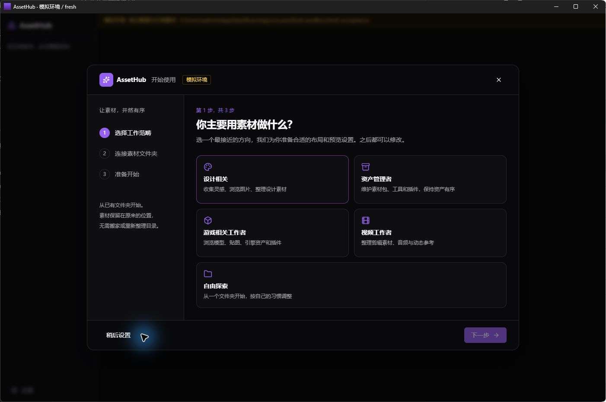
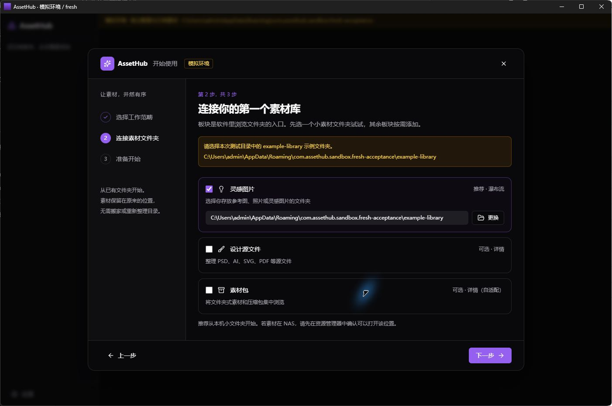
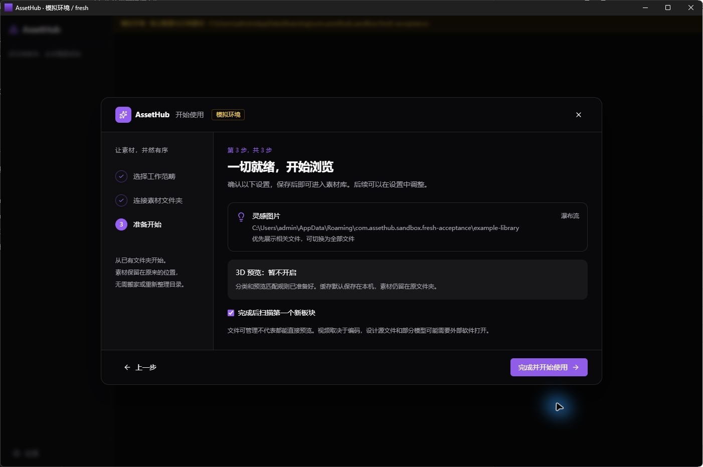
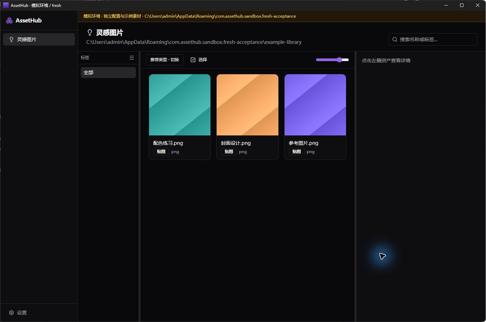
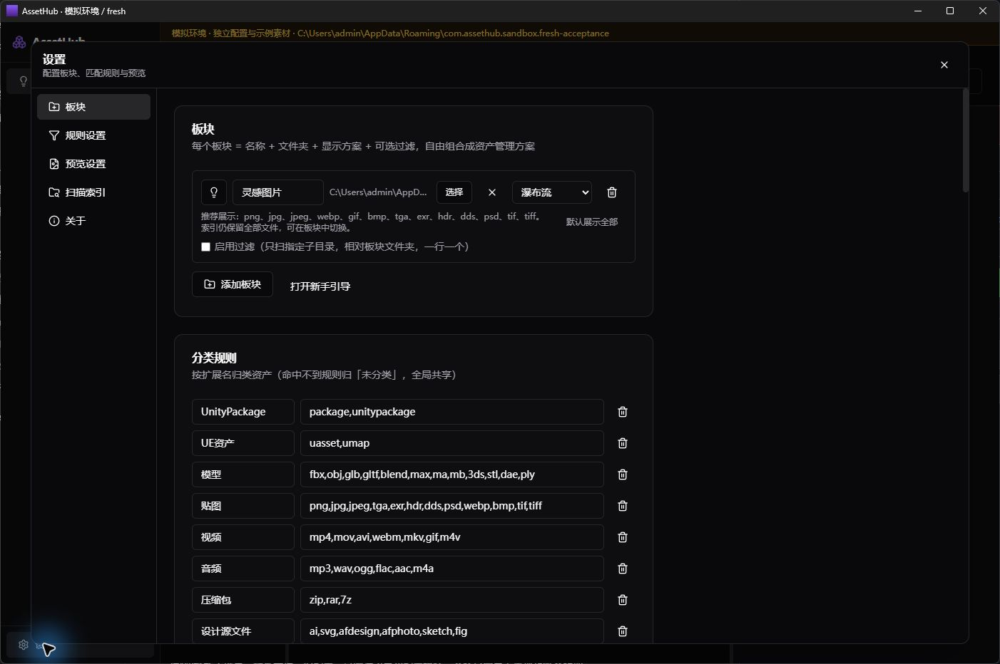

# AssetHub · 第一次使用

**从一个已有文件夹开始，把素材看清楚、找出来。**

[返回首页](../README.md) · [下载公开测试版](https://github.com/Airkria/AssetHub-Releases/releases) · [反馈问题](https://github.com/Airkria/AssetHub-Releases/issues/new/choose)

> **适用版本：2.0.0-alpha.3，Windows 10/11 x64。** 请先在软件的「设置 → 关于」确认版本；旧版 alpha.2 的首次配置方式不同。
>
> 配图来自实际桌面应用的**隔离模拟环境**，使用程序生成的示例素材，保留了「模拟环境」标记。图中的测试路径无需照抄；正常安装后不会显示这些模拟提示。图片看不清时，可点击查看原图。

**你将完成：安装 → 选择工作范畴 → 连接文件夹 → 扫描并浏览。**

## 开始前，准备一个小文件夹

选一个本机已有的文件夹，里面放几张可以公开的图片或素材副本。第一次先用它熟悉操作，之后再连接大素材库。

**素材库**是你存放素材的文件夹；**板块**是 AssetHub 左侧进入该文件夹的入口。例如，「灵感图片」板块可以连接你已有的参考图文件夹。

连接和扫描不会搬动或重排素材。软件中的重命名、删除等文件操作会影响磁盘上的原文件，练习时请使用副本。

## 01 · 下载并安装

1. 打开 [alpha.3 下载页](https://github.com/Airkria/AssetHub-Releases/releases/tag/v2.0.0-alpha.3)，确认版本标题。
2. 展开该版本的 **Assets（附件）**，下载 `AssetHub_2.0.0-alpha.3_x64-setup.exe`。不要下载 `Source code`，也不需要单独打开签名文件。
3. 双击安装包，按安装器提示完成安装，然后打开 AssetHub。不需要安装 Rust、Node.js 或开发工具。

首次安装如果缺少 Microsoft WebView2，安装器会联网下载，请保持网络连接。

如果 Windows 提示「未知发布者」，先核对下载来源；不确定时暂停并联系作者。当前安装包尚无 Windows 发布者证书签名，更新文件的验证签名与此不同。

## 02 · 选择你的工作范畴

首次启动会打开三步引导。点击最接近你用途的方向，再点右下角 **「下一步」**。

本教程以 **「设计相关」** 为例。选择后会提供相应的板块与布局预设，之后仍可调整；不确定选什么时，可以选「自由探索」。



*图 1 · 点击一个工作范畴后，才能继续下一步。*

## 03 · 连接一个素材文件夹

先只保留默认勾选的 **「灵感图片」**，点击它右侧的 **「选择文件夹」**。

在弹出的系统窗口中，找到你准备的小文件夹，选中它并确认。回到引导后，检查显示的路径是否正确，再点 **「下一步」**。如果已经选过目录，按钮会变成「更换」。



*图 2 · 图中的 example-library 是测试目录，请换成你自己的文件夹。*

「设计源文件」「素材包」是可选板块，这次可以不勾选。如果同时启用多个板块，需要分别为它们选择已有目录。

## 04 · 确认，然后开始扫描

确认文件夹路径无误，保留勾选 **「完成后扫描第一个新板块」**，点击 **「完成并开始使用」**。



*图 3 · 这个示例使用图片板块，3D 预览暂不开启，不影响浏览图片。*

扫描会读取目录中的文件信息，建立用于浏览和查找的索引。请等待扫描结束；耗时取决于文件数量和存储位置。

如果你没有勾选自动扫描：先选左侧板块，再打开 **「设置 → 扫描索引 → 扫描当前板块」**。一次创建多个板块时，其余板块也需要切换后分别扫描。

## 05 · 看到素材，就可以开始了

扫描完成后，中间区域会出现素材卡片。点击一张卡片，在右侧查看详情。



*图 4 · 示例库包含三张图片和一个文本文件；当前「推荐类型」只展示图片。*

**现在你已经完成第一次配置。** 下次打开软件，会进入已保存的板块，无需重新走引导。

## 再试三个常用操作

以下操作为文字补充说明，未附逐项操作截图。

| 想做什么 | 怎么操作 |
| --- | --- |
| 找一份素材 | 在右上角「搜索名称或标签…」输入文件名的一部分。清空搜索框可恢复列表。 |
| 给素材做标记 | 点击一张卡片，在右侧详情的「添加标签」中输入，例如「待整理」，按 Enter 或点击加号。确认标注保存完成后再退出。 |
| 回到原文件夹 | 选中一份素材，在右侧点击「打开文件位置」；也可以对单份素材右键，选择同名操作。 |

### 文件在目录里，为什么没显示？

如果列表上方出现 **「推荐类型 · 切换」**，点击它可切到 **「全部文件」**。推荐类型只决定当前展示哪些文件，不会因此删除其他类型的索引；没有推荐类型限制的板块不会出现该按钮。

还没找到时，先清空搜索并取消其他筛选，再确认连接的文件夹是否正确。新放入文件后，可重新扫描当前板块。

## 想换文件夹，或再加一个板块？

打开左下角 **「设置 → 板块」**，可以调整板块的名称、目录和布局，也可以点击 **「打开新手引导」**。



*图 5 · 已有板块时，重新引导只追加所选板块，保留原有板块与全局设置。*

如果第一次点了「稍后设置」，也可以从空白页的引导入口重新开始。连接 NAS 目录前，先确认 Windows 文件资源管理器能正常打开它。

## 更新与反馈

**检查更新：** 打开「设置 → 关于 → 检查更新」。有新版本时，查看说明并下载，再按提示安装和重启。未保存的标注、扫描或模型转换需先处理完成。

**遇到问题：** 到 [GitHub Issues](https://github.com/Airkria/AssetHub-Releases/issues/new/choose) 提交反馈，可以直接按下面填写：

```text
软件版本：（设置 → 关于中查看）
我做了什么：
原本希望发生什么：
实际发生了什么：
是否每次都会发生：
截图或错误提示：
```

Issues 是公开的，截图请先移除私人路径、保密素材和个人信息。私密问题可发送至 **airkria915793472@gmail.com**。

### 测试版需要了解的边界

- 文件可以被管理，不代表都能直接预览。视频能否播放取决于编码，部分设计源文件和模型需要用外部软件打开；本版没有视频/动图滑动预览。
- 先使用个人库；多人同时修改同一共享库标注的冲突处理尚未完成。
- 保存失败的标注目前只保留在本次运行中，请恢复连接并重试成功后再退出。
- 本教程配图验证了隔离桌面环境中的引导与示例扫描，不能替代全新 Windows 安装、alpha.2 升级或 NAS 大库、权限和断网验收。

---

[返回首页](../README.md) · [完整测试边界](../README.md#内测边界与已知问题) · 作者 **Airkria**
